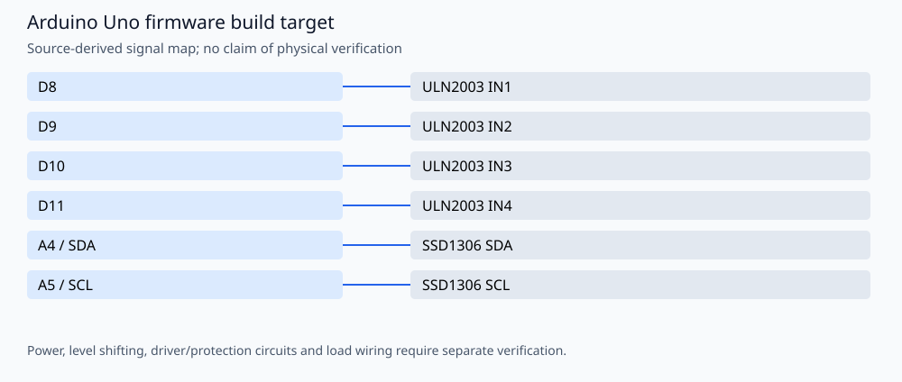

# CableCarousel — Python GUI and Arduino reel selector

A CustomTkinter desktop interface for browsing ten cable reels and sending a reel number over serial to an Arduino stepper controller with an SSD1306 OLED. Author: **Amir Mobasheraghdam**, University of Isfahan.

## Reproducible build

Install Python 3 and **Arduino CLI 1.3.1**, then run from this repository:

```bash
python3 tools/check_firmware.py --install
```

The helper installs `arduino:avr@1.8.6` and `Adafruit BusIO@1.17.0`, `Adafruit GFX Library@1.12.1`, `Adafruit SSD1306@2.5.13`, `Stepper@1.1.3`. It compiles these alternatives
separately in temporary folders, without uploading or rewriting the originals:

- `Arduino_Stepper_OLED_Amir Mobasher_Kabel_with_Angle.ino`

Build target: `arduino:avr:uno`. Once dependencies are installed, omit `--install`
to build offline. `--jobs 2` is the default. Set `ARDUINO_CLI` to a CLI executable
or wrapper when using a custom Arduino configuration. Exact build inputs are in
[`tools/firmware.json`](tools/firmware.json). Library dependencies are listed
explicitly and installed with `--no-deps` so transitive updates cannot silently
replace the pinned versions. These are tested build versions, not a claim that
all other core/library versions are incompatible.

The GitHub Actions workflow repeats the firmware checks on pushes and pull
requests. Compilation validates software/toolchain compatibility; it does not
establish hardware safety or successful physical operation.

## Signal assignments



| Signal | Board pin |
| --- | --- |
| ULN2003 IN1 | D8 |
| ULN2003 IN2 | D9 |
| ULN2003 IN3 | D10 |
| ULN2003 IN4 | D11 |
| SSD1306 SDA | A4 / SDA |
| SSD1306 SCL | A5 / SCL |

## Operation and validation limits

The motor constructor uses **8, 10, 9, 11** to order the phases; that is distinct from the IN1–IN4 wiring order above. Verify the actual motor/driver and use an appropriate motor supply. The OLED is 128×64 at **0x3C**. No motor or homing behavior is changed. The firmware assumes the initial position is reel 1 and has no homing feedback; verify physical alignment and the GUI/firmware metadata mapping before using real reels.

The current GUI is **`kabelkarussell.py`**. `CableCarouselUI` is a separate legacy Python program. The GUI now searches the optional `kabelkarussell_recolored/` override directory, then the image files shipped next to the script, and generates a fallback when neither works. Paths do not depend on the launch directory.

```bash
python3 -m venv .venv
. .venv/bin/activate
python -m pip install -r requirements.txt
python kabelkarussell.py --windowed --port /dev/ttyACM0 --baudrate 9600
python -m unittest discover -s tests -v
```

Python **3.12** was used for validation. Tk and an X/desktop display are needed for the GUI; image-loader tests do not create a window. On Debian/Ubuntu install `python3-tk`; `xvfb-run` can provide a virtual display for smoke tests. Windows may use a COM port. The GUI can start without Arduino and reports the disconnected state. The serial protocol remains a reel number from 1 to 10 followed by a newline at **9600 baud**.

No physical testing, new hardware photographs or measured electrical/optical
performance is claimed. Retain the author attribution and existing license/source
notices when reusing the project.
